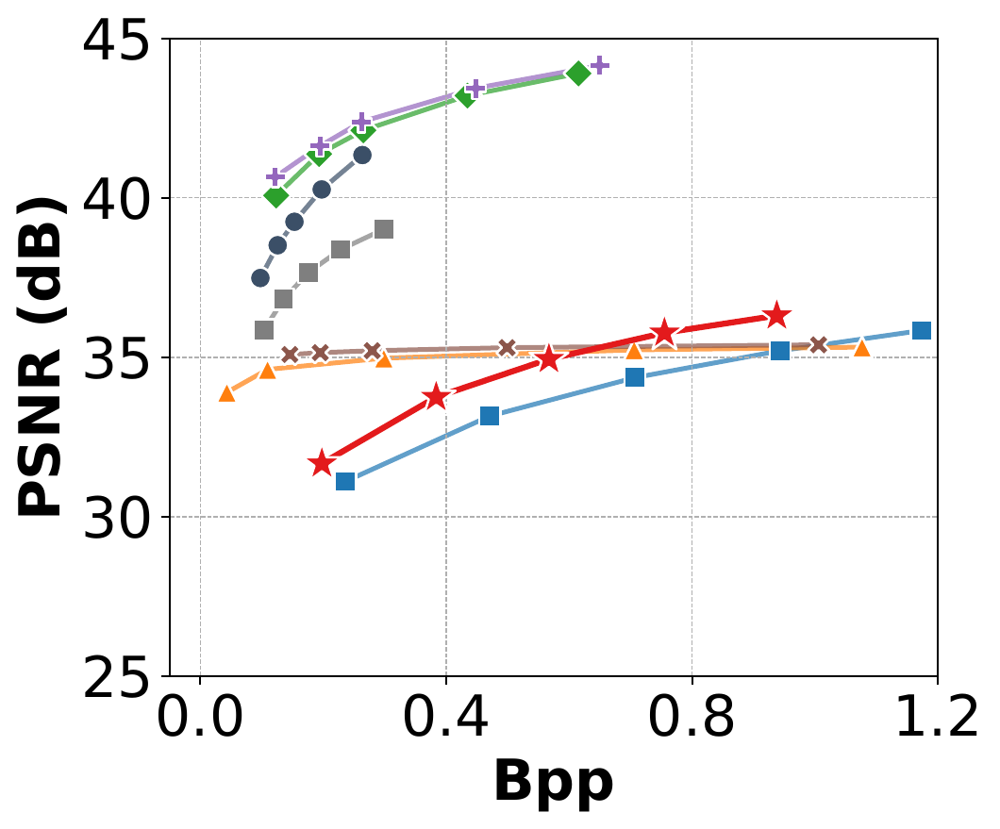
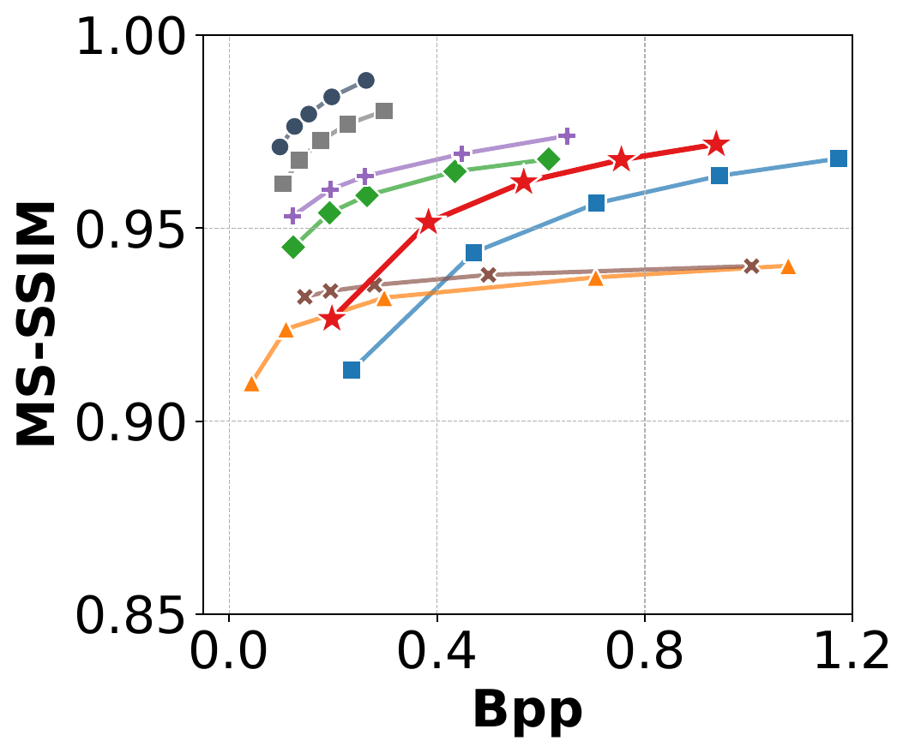
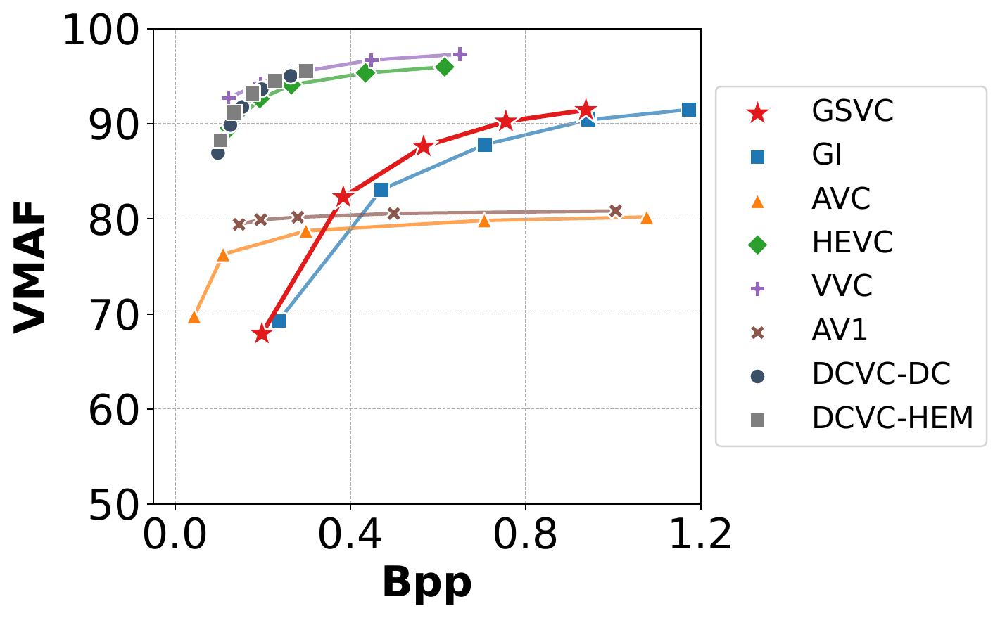
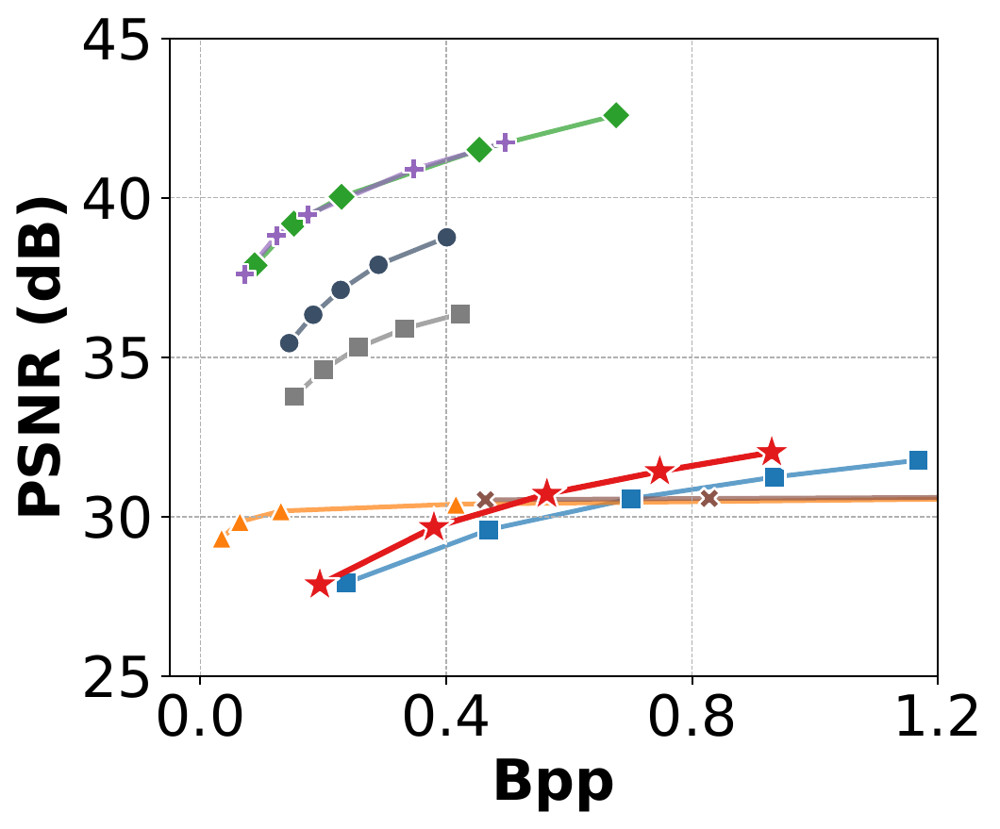
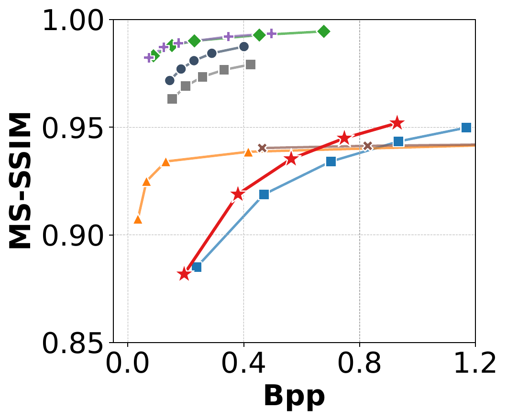
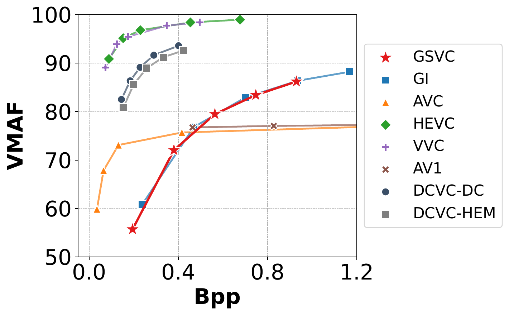
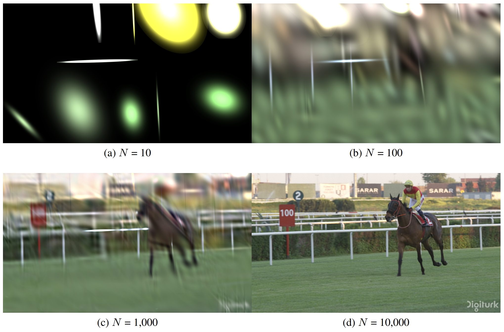
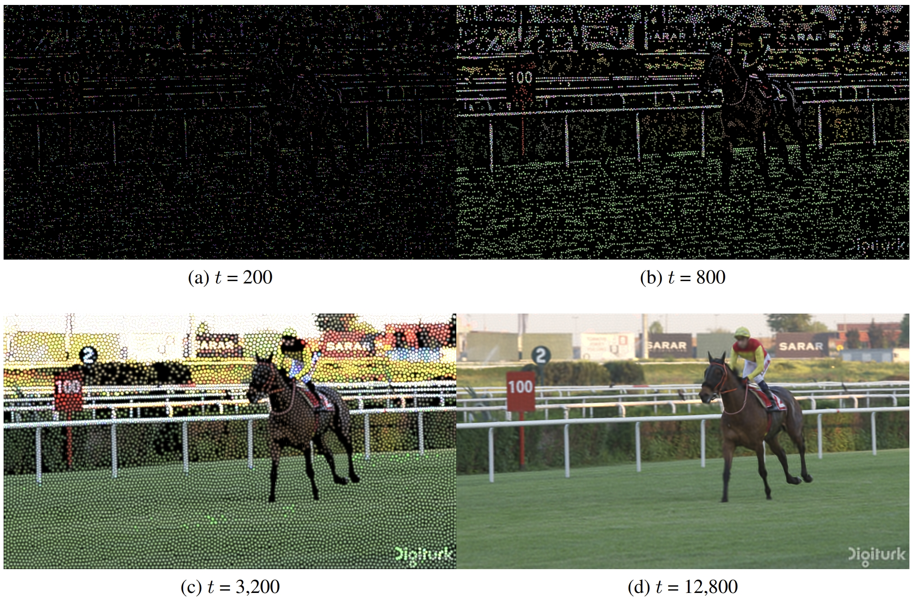

# GSVC: Efficient Video Representation and Compression Through 2D Gaussian Splatting
[](https://arxiv.org/abs/2501.12060)
[](https://github.com/LonganWANG-cs/GSVC)

[[paper](https://arxiv.org/abs/2501.12060)][[project page](https://longanwang-cs.github.io/gsvc/)][[code](https://github.com/LonganWANG-cs/GSVC)]

[Longan Wang](https://longanwang-cs.github.io/), [Yuang Shi](https://yuang-ian.github.io/), [Wei Tsang Ooi📧](https://www.comp.nus.edu.sg/~ooiwt/)
(📧 denotes corresponding author.)

This is the official implementation of our paper [GSVC](https://arxiv.org/abs/2501.12060), a video codec that represents each frame with overlapping 2D Gaussian splats. GSVC learns anchor frames from scratch and initializes propagation frames from their predecessors to exploit temporal redundancy. It detects scene changes from training losses, adds splats to capture large motion or newly appearing objects, and prunes low-contribution splats to control the rate-distortion trade-off.
GSVC also supports two-pass encoding, which refines an anchor frame using splats propagated backward from a future frame. Its residual-based quantization encodes changes in Gaussian parameters between frames for efficient compression. In the paper, GSVC achieves rate-distortion performance comparable to AV1 and VVC implementations and renders 1920 × 1080 video at 1500 fps.


## Experimental Results

We report PSNR, MS-SSIM, and VMAF together for each benchmark. The plots compare GSVC with the evaluated video-codec baselines; the complete, machine-readable measurements are linked below.

<figure style="text-align: center;">
  <div>
    
    
    
  </div>
  <figcaption><strong>Figure 1:</strong> Rate-distortion performance on UVG.</figcaption>
</figure>

<figure style="text-align: center;">
  <div>
    
    
    
  </div>
  <figcaption><strong>Figure 2:</strong> Rate-distortion performance on HEVC Class B.</figcaption>
</figure>

| Benchmark | Metrics | Complete results |
| --- | --- | --- |
| UVG | Bpp, PSNR, MS-SSIM, VMAF | [Download CSV](./img/UVG.csv) |
| HEVC Class B | Bpp, PSNR, MS-SSIM, VMAF | [Download CSV](./img/HEVC-Class-B.csv) |

### Frame Structure Used in the Experiments

The frame structure used to learn the Gaussian representations is separate from the I/P-frame structure used during quantization.

- **UVG overfitting:** anchor frames are selected by DKS. In the reported UVG experiments, only the first frame was selected as an anchor; all remaining frames were propagation frames.
- **HEVC Class B overfitting:** the base GOP contains one anchor frame followed by four propagation frames (`APPPP`). DKS can insert additional anchor frames at detected scene changes. Here, `A` denotes an anchor and `P` denotes a propagation frame.
- **Quantization:** every overfitting anchor frame is encoded as an I-frame. In addition, periodic I-frames follow an `IPPPP` pattern (`--I_interval 5`) to limit quantization error propagation. **Jockey and YachtRide** use `IPP` (`--I_interval 3`) instead. Anchor frames therefore introduce additional I-frames beyond this periodic pattern.

An overfitting anchor is a representation learned independently; a quantization I-frame stores absolute quantized Gaussian parameters. All anchors are I-frames, while periodic I-frames may also occur on propagation frames.

## News

* **2026/10/25**: 🔥 Updated GSVC code, experimental results, and installation instructions. The original release is preserved in [GSVC-25-2-1](https://github.com/LonganWANG-cs/GSVC/tree/GSVC-25-2-1); see [P-GSVC](https://github.com/LonganWANG-cs/PGSVC) for layered progressive image and video representation.
* **2025/2/1**: 🔥 We release our Python and CUDA code for GSVC presented in our paper. Have a try!

## Insight
Figures 3 and 4 illustrate how Gaussian splats can serve as a primitive for representing an image, and how the training process iteratively optimizes the parameters of the Gaussian splats to fit a given image.
<figure style="text-align: center;">
  <div>
    
  </div>
  <figcaption><strong>Figure 3:</strong> Using Gaussian splats to model an image. Image is taken from UVG Jockey video. The sub-figures show that as the number of Gaussian splats N increases, the learned splats increasingly approximate the image’s content.</figcaption>
</figure>

<figure style="text-align: center;">
  <div>
    
  </div>
  <figcaption><strong>Figure 4:</strong> Image taken from UVG Jockey video. Intermediate training results after t iterations for 10,000 Gaussian splats, illustrating how Gaussian splats parameters are optimized to fit the content of a frame.</figcaption>
</figure>


## Play with Our Code

### Cloning the Repository

```shell
# SSH
git clone git@github.com:LonganWANG-cs/GaussianVideo.git
```
or
```shell
# HTTPS
git clone https://github.com/LonganWANG-cs/GaussianVideo.git
```
After cloning the repository, you can follow these steps to train GSVC models under different tasks. 

### Requirements

Use Linux with an NVIDIA GPU, a compatible driver, a CUDA toolkit (`nvcc`), and a C++ compiler. The tested baseline is **Python 3.8, PyTorch 2.3.1 + CUDA 12.1, and the bundled gsplat 0.1.3**. Run the following from the repository root; you may use any environment name.

```bash
conda create -n pGS_GSVC_extension python=3.8 -y
conda activate pGS_GSVC_extension
python -m pip install --upgrade pip setuptools wheel
python -m pip install torch==2.3.1 torchvision==0.18.1 \
  --index-url https://download.pytorch.org/whl/cu121
python -m pip install -r requirements.txt
```

The PyTorch command follows the [official installation instructions](https://pytorch.org/get-started/previous-versions/#v231). Python dependencies are listed in `requirements.txt`.

#### Install gsplat

After installing PyTorch and the Python dependencies, run the installer on a GPU machine:

```bash
bash ensure_gsvc_gsplat.sh
```

The script detects the active Python environment, CUDA toolkit, and GPU architecture, installs gsplat dependencies, and builds the bundled extension. Re-running it reuses a matching build. A CUDA toolkit with `nvcc` and a compatible C++ compiler must be installed separately; PyTorch's bundled CUDA runtime does not include `nvcc`.

If the toolkit is not detected, specify its path, for example:

```bash
CUDA_HOME=/usr/local/cuda-12.1 bash ensure_gsvc_gsplat.sh
```

Use a toolkit compatible with your PyTorch build. The script also accepts `TORCH_CUDA_ARCH_LIST` for custom GPU targets.

#### Data and Runtime Configuration

Download [UVG](https://ultravideo.fi/dataset.html) or use another raw **8-bit YUV420** sequence. Set its path, name, width, and height; the default resolution is 1920 × 1080.

Training parameters are command-line arguments. Runtime defaults are in `gsvc_runtime.py`, with `GSVC_*` environment overrides taking precedence. Effective settings and environment information are logged at startup. No exports are needed for the defaults.

Deterministic integer accumulation is off by default because rounding can reduce gradient precision and reconstruction quality. For a reproducibility run, keep seeds, settings, hardware, and software fixed and optionally override:

```bash
export GSVC_DET_ATOMICS=1
export GSVC_DETERMINISTIC_TORCH=1
```

Alternatively, set both defaults to `"1"` in `gsvc_runtime.py`. Initialization supplies `CUBLAS_WORKSPACE_CONFIG=:4096:8` automatically when determinism is enabled and the variable is unset.

### File Structure and Three-Stage Workflow

```text
.
├── train_GSVC_overfitting.py  # Learn per-frame Gaussian representations.
├── GSVC_overfitting.py        # Gaussian model and representation optimization.
├── train_GSVC_encoder.py      # Quantization-aware optimization and checkpoint export.
├── GSVC_encoder.py            # I/P-frame quantization models.
├── test_GSVC_decoder.py       # Dequantize checkpoints, render frames, and evaluate.
├── GSVC_decoder.py            # Reconstruct Gaussian parameters for rendering.
├── quantize.py                # Scalar/vector quantizers and bit-accounting helpers.
├── optimizer.py               # Adan optimizer.
├── utils.py                   # Data loading, metrics, logging, and video output.
├── gsvc_runtime.py            # Shared runtime defaults and environment configuration.
├── gsplat/                    # Bundled Python/CUDA rasterization extension.
├── ensure_gsvc_gsplat.sh       # Install/check the bundled CUDA extension.
├── sh_train_GSVC_example.sh    # Optional batch example running all three stages.
├── requirements.txt           # Python runtime dependencies.
├── checkpoints/               # Generated overfitting models, logs, and previews.
├── checkpoints_quant/         # Generated quantized models and decoded previews.
└── output/                    # Optional batch-job logs.
```

**Overfitting** generates a Gaussian representation for each frame. **Encoder** compresses that representation through quantization and saves quantized values, and reconstruction metadata. **Decoder** dequantizes the saved values, reconstructs absolute or residual Gaussian parameters, and renders the frames without retraining.

The encoder saves quantized data in a PyTorch checkpoint. Its serialized `.pth` size includes metadata and is not the reported parameter bitrate.

### Manual Training Example

With your environment activated and gsplat installed, run all three stages from the repository root in the same shell.

This example uses **Beauty's first 50 frames**, **10,000 points**, and **50,000 iterations per frame**. Preview videos use **24 FPS**, without resampling the input frames.

```bash
DATASET=/path/to/UVG/Beauty/Beauty_1920x1080_120fps_420_8bit_YUV.yuv
DATA_NAME=Beauty
ITERATIONS=50000
IMAGE_LENGTH=50
NUM_POINTS=10000
```

#### Step 1: Overfitting — Generate Gaussian Representations

```bash
python train_GSVC_overfitting.py \
  --dataset "${DATASET}" \
  --data_name "${DATA_NAME}" \
  --width 1920 --height 1080 \
  --loss_type L2 \
  --num_points "${NUM_POINTS}" \
  --savdir GSVC_overfitting_UVG \
  --savdir_m GSVC_overfitting_UVG_m \
  --iterations "${ITERATIONS}" \
  --image_length "${IMAGE_LENGTH}" \
  --fps 24 --seed 1 \
  --look_ahead 1 --is_rm --is_ad --save_everyframes
```

`--look_ahead 1` enables two-pass refinement; `--is_rm` enables pruning and `--is_ad` enables adaptive Gaussian control. Look-ahead and DKS preprocessing add work beyond the main per-frame iteration budget.

The Gaussian representation checkpoint is saved to:

```text
checkpoints/GSVC_overfitting_UVG_m/Beauty/GaussianVideo_50000_10000/gmodels_state_dict.pth
```


#### Step 2: Encoder — Quantize and Save the Compressed Representation

```bash
MODEL_PATH="checkpoints/GSVC_overfitting_UVG_m/${DATA_NAME}/GaussianVideo_${ITERATIONS}_${NUM_POINTS}/gmodels_state_dict.pth"

python train_GSVC_encoder.py \
  --model_path "${MODEL_PATH}" \
  --dataset "${DATASET}" \
  --data_name "${DATA_NAME}" \
  --width 1920 --height 1080 \
  --num_points "${NUM_POINTS}" \
  --savdir GSVC_encode_UVG \
  --savdir_m GSVC_encode_UVG_m \
  --iterations "${ITERATIONS}" \
  --image_length "${IMAGE_LENGTH}" \
  --fps 24 --seed 1 \
  --I_interval 5 --is_rm --save_everyimgs
```

`--I_interval 5` adds periodic I-frames in an `IPPPP` pattern; use `3` for Jockey or YachtRide (`IPP`). All overfitting anchors must also be I-frames.

The encoder saves the quantized checkpoint to:

```text
checkpoints_quant/GSVC_encode_UVG_m/Beauty/GaussianVideo_50000_10000/encoded_gmodels_state_dict.pth
```

#### Step 3: Decoder — Dequantize and Render

```bash
ENCODED_PATH="checkpoints_quant/GSVC_encode_UVG_m/${DATA_NAME}/GaussianVideo_${ITERATIONS}_${NUM_POINTS}/encoded_gmodels_state_dict.pth"

python test_GSVC_decoder.py \
  --model_path "${ENCODED_PATH}" \
  --dataset "${DATASET}" \
  --data_name "${DATA_NAME}" \
  --width 1920 --height 1080 \
  --savdir GSVC_decode_UVG \
  --image_length "${IMAGE_LENGTH}" \
  --fps 24 --save_imgs
```

The decoder reconstructs I/P frames from the quantized checkpoint without retraining. Its CLI uses the reference YUV sequence for dimensions and PSNR/MS-SSIM evaluation.

Decoded PNGs, logs, and `video/video.mp4` are placed under:

```text
checkpoints_quant/GSVC_decode_UVG/Beauty/GaussianVideo_<frame_point_count>/
```


### Optional: Batch Execution

The manual commands above work on a local GPU machine or GPU server without a scheduler. For Slurm users, `sh_train_GSVC_example.sh` runs all three stages. Adjust its repository path, environment, dataset, and resource settings, then submit:

```bash
mkdir -p output  # Create before submission so the scheduler can open its logs.
sbatch sh_train_GSVC_example.sh
```

The batch script uses 50 frames, 50,000 iterations, and several point budgets. For Jockey or YachtRide, change its encoder argument to `--I_interval 3`.

On shared clusters, run CUDA builds and training on an allocated GPU node.

## Acknowledgments

Our code was developed based on [GaussianImage](https://github.com/Xinjie-Q/GaussianImage). 
This is a paradigm of image representation and compression by 2D Gaussian Splatting.


## Citation

If you find our GSVC useful or relevant to your research, please kindly cite our paper:

```
@article{wang2025gsvc,
  title={GSVC: Efficient Video Representation and Compression Through 2D Gaussian Splatting},
  author={Wang, Longan and Shi, Yuang and Ooi, Wei Tsang},
  journal={arXiv preprint arXiv:2501.12060},
  year={2025}
}
```
